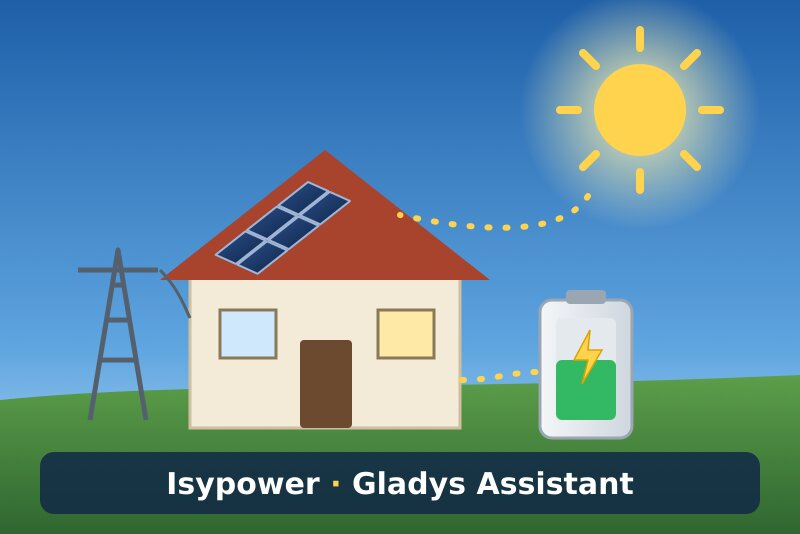
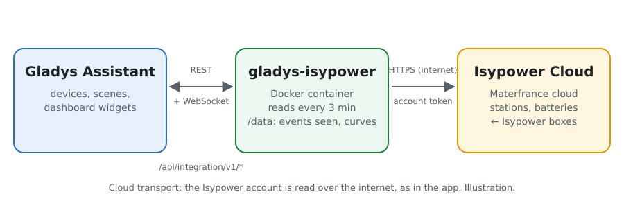
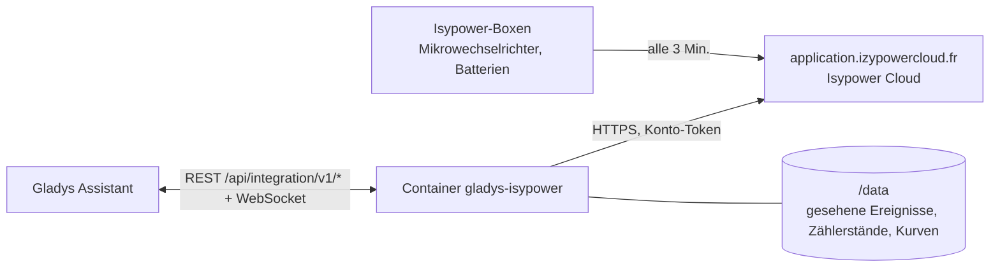
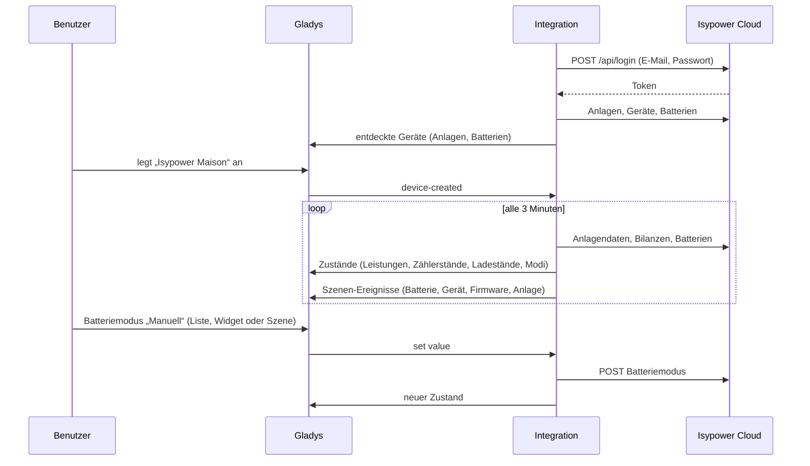
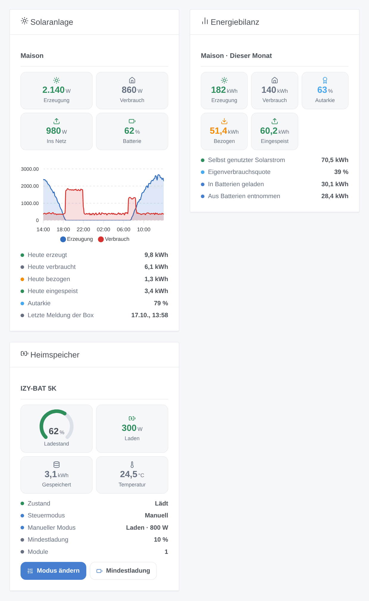

# Gladys Isypower

[English](README.md) · [Français](README.fr.md) · **Deutsch** · [Español](README.es.md)

[](LICENSE)
[](https://github.com/William-De71/gladys-isypower/releases)
[](https://github.com/William-De71/gladys-isypower/actions/workflows/release.yml)
[](https://gladysassistant.com)



Externe Integration von [Gladys Assistant](https://gladysassistant.com) für **Isypower Cloud** (Materfrance, früher Izypower): Solarerzeugung, Hausverbrauch, Netzaustausch und Heimspeicher Ihrer Anlage, mit Energiezählerständen für die Energieauswertung von Gladys, Batteriemodi, Szenen und Dashboard-Widgets. Sie liest die Cloud der App Isypower Cloud mit Ihrem Konto.

Benutzerdokumentation: [English](docs/en.md) · [Français](docs/fr.md) · [Deutsch](docs/de.md) · [Español](docs/es.md).

> Community-Integration, weder von Materfrance entwickelt noch unterstützt. Die API von Isypower Cloud ist nicht dokumentiert: Sie wird so genutzt wie in der [Home-Assistant-Integration izypower_cloud](https://github.com/StefanPlizga/izypower_cloud).

## Funktionen

- **Ein Gerät pro Anlage**: Solarerzeugung, Hausverbrauch, vorzeichenbehafteter Netzaustausch, Batteriestand und -leistungen.
- **Energiezählerstände** für Gladys: Solarerzeugung, aus dem Netz bezogene Energie (Verbrauch und Kosten), eingespeiste Energie, in die Batterien geladene und entnommene Energie. Ein Zählerstand sinkt nie.
- **Ein Gerät pro Batterie**: Ladestand, gespeicherte Energie, Lade- und Entladeleistung, Temperatur, Notstromsteckdose sowie **Steuermodus** und **manueller Modus** als Auswahllisten.
- **4 Szenen-Auslöser**, **3 Szenen-Aktionen** und **3 Dashboard-Widgets** (siehe unten).
- Standardmäßig Abfrage alle 3 Minuten (die Boxen melden alle 3 Minuten); eine abgelehnte Anmeldung stoppt die Abfragen, damit das Konto nie gesperrt wird.
- Vier Sprachen überall: Englisch, Französisch, Deutsch, Spanisch.

## Funktionsweise





Die Integration meldet sich mit E-Mail und Passwort der App an, listet die Anlagen des Kontos und liest bei jeder Abfrage die Live-Daten jeder Anlage (Leistungen, Batteriestand, letzte Meldung der Box), die Tages- und Gesamtbilanz, ihre Geräte (Mikrowechselrichter, Batterien, Zähler, Ladestationen) sowie Live-Daten und Einstellungen jeder Batterie. Sie vergleicht sie mit der vorherigen Abfrage, um die Szenen-Auslöser zu feuern, und veröffentlicht nur geänderte Werte.



### Transport

Nur Cloud (`transports: ["cloud"]`): Gladys zeigt das Abzeichen **Cloud**. Die Daten verlassen Ihr Netz über die Cloud von Materfrance, genau wie mit der App. Im lokalen Netz wird nichts gelesen.

## Geräte und Funktionen

| Gerät               | Funktion                                     | Kategorie / Typ                                       | Einheit |
| ------------------- | -------------------------------------------- | ----------------------------------------------------- | ------- |
| Isypower <Anlage>   | Solarerzeugung                               | `energy-production-sensor` / `power`                  | W       |
|                     | Zählerstand Solarerzeugung                   | `energy-production-sensor` / `index`                  | kWh     |
|                     | Hausverbrauch                                | `energy-sensor` / `power`                             | W       |
|                     | Netzaustausch (Bezug > 0, Einspeisung < 0)   | `grid-sensor` / `power`                               | W       |
|                     | Aus dem Netz bezogene Energie                | `energy-sensor` / `index`                             | kWh     |
|                     | Ins Netz eingespeiste Energie                | `grid-sensor` / `output-index`                        | kWh     |
|                     | Batteriestand (mit Batterie)                 | `battery-storage` / `battery-level`                   | %       |
|                     | Batterieladung / -entladung                  | `battery-storage` / `charge-power`, `discharge-power` | W       |
|                     | In Batterien geladene / entnommene Energie   | `battery-storage` / `charge-index`, `discharge-index` | kWh     |
| Isypower <Batterie> | Ladestand                                    | `battery-storage` / `battery-level`                   | %       |
|                     | Gespeicherte Energie                         | `battery-storage` / `battery-energy-remaining`        | kWh     |
|                     | Lade- / Entladeleistung                      | `battery-storage` / `charge-power`, `discharge-power` | W       |
|                     | Temperatur                                   | `device-temperature-sensor` / `decimal`               | °C      |
|                     | Notstromsteckdose                            | `home-output-sensor` / `off-grid-power`               | W       |
|                     | Steuermodus (Master oder Einzelbatterie)     | `text` / `select`                                     |         |
|                     | Manueller Modus (Master oder Einzelbatterie) | `text` / `select`                                     |         |

Nur der Zählerstand der **bezogenen** Energie speist Verbrauch und Kosten in Gladys: Das ist es, was die Rechnung zählt.

## Szenen-Auslöser, Aktionen und Widgets



| Art      | Schlüssel                      | Verwendung                                                                                                |
| -------- | ------------------------------ | --------------------------------------------------------------------------------------------------------- |
| Auslöser | `battery_state_changed`        | Eine Batterie beginnt zu laden, zu entladen oder geht in Standby.                                         |
| Auslöser | `equipment_connection_changed` | Ein Mikrowechselrichter, eine Batterie, ein Zähler oder eine Ladestation geht offline oder wieder online. |
| Auslöser | `firmware_update_available`    | Isypower bietet eine neue Firmware an (alle sechs Stunden geprüft).                                       |
| Auslöser | `station_reporting_changed`    | Die Box hat seit 20 Minuten nichts gesendet, oder meldet wieder.                                          |
| Aktion   | `set_battery_mode`             | Steuermodus; manuell Standby, Laden oder Entladen mit einer Leistung.                                     |
| Aktion   | `set_minimum_charge`           | Mindestladung einer Batterie (5 bis 100 %).                                                               |
| Aktion   | `get_energy_report`            | Energie eines Zeitraums, Autarkie und eine fertige Zusammenfassung.                                       |
| Widget   | `overview`                     | Solaranlage jetzt, Kurven der letzten 24 Stunden, Energie des Tages.                                      |
| Widget   | `report`                       | Bilanz von heute, des Monats, des Jahres oder seit Installation.                                          |
| Widget   | `battery`                      | Eine Batterie, mit Schaltflächen für Modus und Mindestladung.                                             |

Beispiele:

- Jeden Abend um 21 Uhr → **Energiebilanz lesen** für heute → ihre Zusammenfassung per Telegram senden.
- Zu Beginn des Hochtarifs → **Batteriemodus** auf manuelles Entladen mit 800 W; am Ende → zurück auf Zeitplan.
- Wenn ein Mikrowechselrichter **offline** geht oder die Anlage **stumm** ist → eine Benachrichtigung senden.

## Voraussetzungen

- Gladys Assistant **5.2.0** oder neuer (Schaltflächen mit Formular, Auswahllisten). Ältere Instanzen können die Integration nicht installieren.
- Ein Isypower-Cloud-Konto mit mindestens einer Anlage und Internetzugang für Gladys.

## Installation

- **Aus dem Store** von Gladys (Integrationen → Externe Integrationen), mit einem Klick, sobald indexiert.
- **Über die URL des Repositorys**: `https://github.com/William-De71/gladys-isypower`.
- **Entwicklermodus**: das Image lokal bauen (`docker build -t gladys-isypower .`) und in Gladys installieren.

## Konfiguration

| Feld              | Beschreibung                                                            |
| ----------------- | ----------------------------------------------------------------------- |
| E-Mail            | Die E-Mail-Adresse des Isypower-Cloud-Kontos.                           |
| Passwort          | Sein Passwort (ein Geheimnis: nie wieder angezeigt, nie protokolliert). |
| Abfrage alle      | 3 (Standard), 5, 10 oder 15 Minuten.                                    |
| Sprache der Texte | Gerätenamen, Batteriemodi, Szenen-Zusammenfassungen.                    |

Schaltflächen: **Jetzt lesen** (höchstens einmal pro Minute, versucht auch eine abgelehnte Anmeldung erneut) und **Diagnose** (schreibt das Gelesene und den Aufbau der Antworten in den Reiter Protokolle, ohne Passwort, Token und Seriennummern).

## Verwendung

1. E-Mail und Passwort der App eingeben und speichern.
2. Im Reiter **Entdecken** die Geräte der Anlagen und Batterien anlegen.
3. Die Widgets **Solaranlage**, **Energiebilanz** und **Heimspeicher** zu einem Dashboard hinzufügen und Szenen mit den obigen Auslösern und Aktionen bauen.

## Entwicklung

```bash
npm install
npm test                       # node --test, nie mit dem Netz
npm run lint && npm run format:check
npx github:GladysAssistant/integration-store . --skip-image-check
scripts/build-cover.sh         # cover.jpg aus docs/assets/cover.svg
docs/illustrations/render.sh   # docs/assets/widgets.<Sprache>.png
node .github/scripts/release.mjs next
```

Lokal liest das SDK `GLADYS_HOST_API_URL`, `GLADYS_INTEGRATION_TOKEN` und `GLADYS_INTEGRATION_SELECTOR`; `DEBUG=gladys-integration-sdk` zeigt die SDK-Protokolle und prüft jeden Widget-Inhalt. Die Tests nutzen eine nachgebildete Isypower Cloud (`test/helpers/fixtures.js`), deren Antworten aus der Home-Assistant-Integration rekonstruiert, nicht mitgeschnitten sind. Die Regeln des Projekts stehen in [CLAUDE.md](CLAUDE.md).

## Release-Prozess


Jeder Merge auf `main` startet die CI und berechnet dann die Version aus den [Conventional Commits](https://www.conventionalcommits.org/) seit dem letzten Tag: `feat` → Minor, `fix` / `perf` → Patch, `!` oder `BREAKING CHANGE` → Major (ein Minor unter 1.0.0); `docs`, `chore`, `ci`, `test`, `style`, `refactor`, `build` allein veröffentlichen nichts. Der Changelog-Abschnitt wird erzeugt, der Tag gepusht, das Multi-Architektur-Image gebaut, dann erhält `main` den Release-Commit, die GitHub Release wird erstellt und ein letzter Job prüft das öffentliche Image, den Store-Validator und das Topic.

- Der Titel des Pull Requests wird zum Squash-Commit und dann zur Changelog-Zeile: auf Englisch, für den Benutzer schreiben (`pr-title.yml` prüft ihn). `CHANGELOG.md` nie von Hand bearbeiten.
- 1.0.0 ist eine Entscheidung: Actions → Release → Run workflow mit `release-as: 1.0.0`. `dry-run` zeigt Version und Notizen, ohne etwas zu veröffentlichen.
- **Geschützter Branch**: Die Release pusht ihren Commit mit `GITHUB_TOKEN` auf `main`. Mit einem Ruleset auf `main` GitHub Actions in die Bypass-Liste aufnehmen (oder über eine GitHub App pushen), sonst schlägt der Veröffentlichungs-Job mit Anweisungen fehl.
- Nach der ersten Release das Paket `ghcr.io` öffentlich machen (Package settings → Change visibility), sonst kann Gladys es nicht laden.

## Fehlerbehebung

Siehe [docs/de.md](docs/de.md#fehlerbehebung). Probleme mit den Versionen von Gladys und der Integration, Ihren Geräten und den Zeilen der Schaltfläche **Diagnose** melden.

## Mitwirken

Issues und Pull Requests sind willkommen. Vor einem Pull Request `npm run format:check && npm run lint && npm test` ausführen und keine externe ID und keinen gespeicherten Schlüssel ändern (siehe [CLAUDE.md](CLAUDE.md)). Mitschnitte echter API-Antworten (ohne persönliche Daten) sind sehr willkommen: Die Integration wurde ohne Konto geschrieben.

## Sicherheit

Siehe [SECURITY.md](SECURITY.md): Sicherheitslücken vertraulich melden. Das Passwort ist ein Geheimnis von Gladys und wird nur per HTTPS an Isypower Cloud gesendet; weder Passwort noch Token werden in `/data` oder in die Protokolle geschrieben. Der Container läuft schreibgeschützt und ohne Root-Rechte.

## Screenshots folgen

Die Bilder oben sind Illustrationen, keine Screenshots. Echte Screenshots kommen nach `docs/assets/screenshots/` (PNG, 1280 × 800): `configuration.png`, `discovery.png`, `station-device.png`, `battery-device.png`, `scene.png`.

## Lizenz

[Apache License 2.0](LICENSE) — siehe auch [NOTICE](NOTICE). Dank an die Dokumentation und das SDK von Gladys sowie an Stefan Plizga für die Home-Assistant-Integration izypower_cloud (MIT), die gezeigt hat, wie die API von Isypower Cloud funktioniert.
