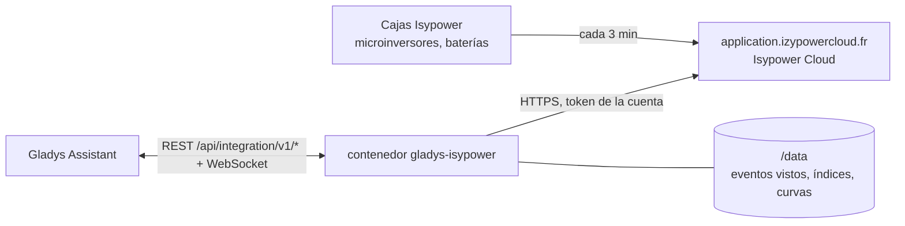
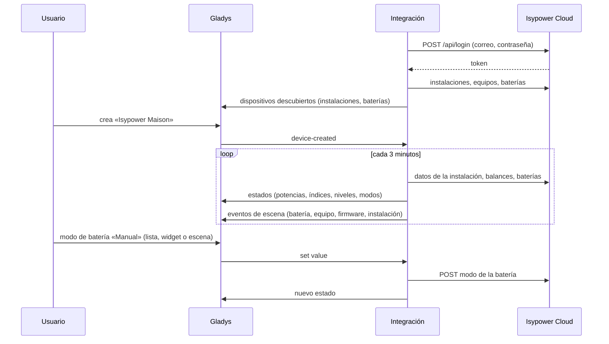
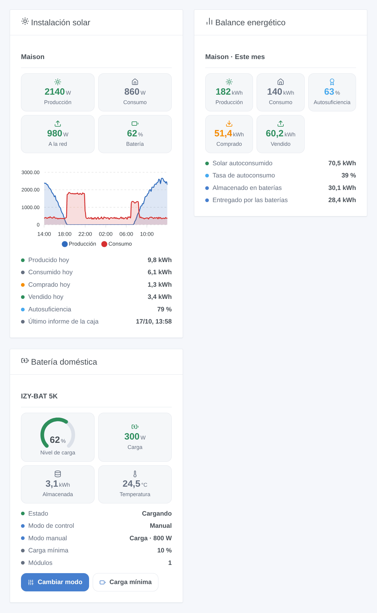

# Gladys Isypower

[English](README.md) · [Français](README.fr.md) · [Deutsch](README.de.md) · **Español**

[](LICENSE)
[](https://github.com/William-De71/gladys-isypower/releases)
[](https://github.com/William-De71/gladys-isypower/actions/workflows/release.yml)
[](https://gladysassistant.com)


Integración externa de [Gladys Assistant](https://gladysassistant.com) para **Isypower Cloud** (Materfrance, antes Izypower): la producción solar, el consumo de la casa, el intercambio con la red y las baterías domésticas de su instalación, con índices de energía para el seguimiento energético de Gladys, modos de batería, escenas y widgets. Lee la nube de la aplicación Isypower Cloud con su cuenta.

Documentación de usuario: [English](docs/en.md) · [Français](docs/fr.md) · [Deutsch](docs/de.md) · [Español](docs/es.md).

> Integración comunitaria, ni desarrollada ni respaldada por Materfrance. La API de Isypower Cloud no está documentada: se usa como lo hace la [integración de Home Assistant izypower_cloud](https://github.com/StefanPlizga/izypower_cloud).

## Funcionalidades

- **Un dispositivo por instalación**: producción solar, consumo de la casa, intercambio con la red con signo, nivel y potencias de las baterías.
- **Índices de energía** para Gladys: producción solar, energía comprada a la red (consumo y coste), energía vendida, energía almacenada y entregada por las baterías. Un índice nunca baja.
- **Un dispositivo por batería**: nivel, energía almacenada, potencias de carga y descarga, temperatura, toma de emergencia, y su **modo de control** y su **modo manual** como listas desplegables.
- **4 disparadores**, **3 acciones de escena** y **3 widgets** (más abajo).
- Lectura cada 3 minutos por defecto (las cajas envían cada 3 minutos); un inicio de sesión rechazado detiene las lecturas para no bloquear nunca la cuenta.
- Cuatro idiomas en todo: inglés, francés, alemán, español.

## Cómo funciona




La integración inicia sesión con el correo y la contraseña de la aplicación, lista las instalaciones de la cuenta y lee, en cada lectura, los datos en directo de cada instalación (potencias, nivel de las baterías, último informe de la caja), los balances del día y desde la instalación, sus equipos (microinversores, baterías, contadores, cargadores) y los datos y ajustes de cada batería. Los compara con la lectura anterior para lanzar los disparadores, y solo publica los valores que han cambiado.



### Transporte

Solo nube (`transports: ["cloud"]`): Gladys muestra la insignia **nube**. Los datos salen de su red por la nube de Materfrance, exactamente como con la aplicación. No se lee nada en la red local.

## Dispositivos y funciones

| Dispositivo            | Función                                         | Categoría / tipo                                      | Unidad |
| ---------------------- | ----------------------------------------------- | ----------------------------------------------------- | ------ |
| Isypower <instalación> | Producción solar                                | `energy-production-sensor` / `power`                  | W      |
|                        | Índice de producción solar                      | `energy-production-sensor` / `index`                  | kWh    |
|                        | Consumo de la casa                              | `energy-sensor` / `power`                             | W      |
|                        | Intercambio con la red (compra > 0, venta < 0)  | `grid-sensor` / `power`                               | W      |
|                        | Energía comprada a la red                       | `energy-sensor` / `index`                             | kWh    |
|                        | Energía vendida a la red                        | `grid-sensor` / `output-index`                        | kWh    |
|                        | Nivel de las baterías (con batería)             | `battery-storage` / `battery-level`                   | %      |
|                        | Carga / descarga de las baterías                | `battery-storage` / `charge-power`, `discharge-power` | W      |
|                        | Energía almacenada / entregada por las baterías | `battery-storage` / `charge-index`, `discharge-index` | kWh    |
| Isypower <batería>     | Nivel de carga                                  | `battery-storage` / `battery-level`                   | %      |
|                        | Energía almacenada                              | `battery-storage` / `battery-energy-remaining`        | kWh    |
|                        | Potencia de carga / descarga                    | `battery-storage` / `charge-power`, `discharge-power` | W      |
|                        | Temperatura                                     | `device-temperature-sensor` / `decimal`               | °C     |
|                        | Toma de emergencia                              | `home-output-sensor` / `off-grid-power`               | W      |
|                        | Modo de control (maestra o independiente)       | `text` / `select`                                     |        |
|                        | Modo manual (maestra o independiente)           | `text` / `select`                                     |        |

Solo el índice de la energía **comprada** alimenta el consumo y el coste en Gladys: es lo que cuenta la factura.

## Disparadores, acciones de escena y widgets



| Tipo       | Clave                          | Uso                                                                              |
| ---------- | ------------------------------ | -------------------------------------------------------------------------------- |
| Disparador | `battery_state_changed`        | Una batería empieza a cargar, a descargar o pasa a espera.                       |
| Disparador | `equipment_connection_changed` | Un microinversor, una batería, un contador o un cargador se desconecta o vuelve. |
| Disparador | `firmware_update_available`    | Isypower ofrece un nuevo firmware (comprobado cada seis horas).                  |
| Disparador | `station_reporting_changed`    | La caja no ha enviado nada en 20 minutos, o vuelve a enviar.                     |
| Acción     | `set_battery_mode`             | Modo de control; en manual espera, carga o descarga a una potencia.              |
| Acción     | `set_minimum_charge`           | Carga mínima de una batería (5 a 100 %).                                         |
| Acción     | `get_energy_report`            | Energía de un periodo, autosuficiencia y un resumen listo.                       |
| Widget     | `overview`                     | Instalación solar ahora, curvas de las últimas 24 horas, energía del día.        |
| Widget     | `report`                       | Balance de hoy, del mes, del año o desde la instalación.                         |
| Widget     | `battery`                      | Una batería, con botones para su modo y su carga mínima.                         |

Ejemplos:

- Cada noche a las 21 h → **leer el balance energético** de hoy → enviar su resumen por Telegram.
- Al empezar las horas punta → **cambiar el modo de la batería** a descarga manual a 800 W; al terminar → volver al calendario.
- Cuando un microinversor se **desconecta** o la instalación queda **sin datos** → enviar una notificación.

## Requisitos

- Gladys Assistant **5.2.0** o posterior (formularios de botones, listas desplegables). Las instancias más antiguas no pueden instalar la integración.
- Una cuenta de Isypower Cloud con al menos una instalación, y acceso a internet desde Gladys.

## Instalación

- **Desde la tienda** de Gladys (Integraciones → Integraciones externas), con un clic, una vez indexada.
- **Desde la URL del repositorio**: `https://github.com/William-De71/gladys-isypower`.
- **Modo desarrollador**: construya la imagen en local (`docker build -t gladys-isypower .`) e instálela desde Gladys.

## Configuración

| Campo                | Descripción                                                               |
| -------------------- | ------------------------------------------------------------------------- |
| Correo electrónico   | El correo de la cuenta de Isypower Cloud.                                 |
| Contraseña           | Su contraseña (un secreto: nunca se vuelve a mostrar ni se registra).     |
| Leer cada            | 3 (por defecto), 5, 10 o 15 minutos.                                      |
| Idioma de los textos | Nombres de los dispositivos, modos de las baterías, resúmenes de escenas. |

Botones: **Leer ahora** (como mucho una vez por minuto, también reintenta un inicio de sesión rechazado) y **Diagnóstico** (escribe lo leído y la forma de las respuestas en la pestaña Registros, sin la contraseña, el token ni los números de serie).

## Uso

1. Introduzca el correo y la contraseña de la aplicación y guarde.
2. En la pestaña **Descubrir**, cree los dispositivos de las instalaciones y de las baterías.
3. Añada los widgets **Instalación solar**, **Balance energético** y **Batería doméstica** a un panel, y cree escenas con los disparadores y acciones de arriba.

## Desarrollo

```bash
npm install
npm test                       # node --test, nunca toca la red
npm run lint && npm run format:check
npx github:GladysAssistant/integration-store . --skip-image-check
scripts/build-cover.sh         # cover.jpg desde docs/assets/cover.svg
docs/illustrations/render.sh   # docs/assets/widgets.<idioma>.png
node .github/scripts/release.mjs next
```

En local, el SDK lee `GLADYS_HOST_API_URL`, `GLADYS_INTEGRATION_TOKEN` y `GLADYS_INTEGRATION_SELECTOR`; `DEBUG=gladys-integration-sdk` muestra los registros del SDK y comprueba cada contenido de widget. Las pruebas usan un Isypower Cloud simulado (`test/helpers/fixtures.js`) cuyas respuestas se han reconstruido a partir de la integración de Home Assistant, no capturado. Las reglas del proyecto están en [CLAUDE.md](CLAUDE.md).

## Proceso de publicación


Cada fusión en `main` lanza la CI y luego calcula la versión a partir de los [Conventional Commits](https://www.conventionalcommits.org/) desde la última etiqueta: `feat` → menor, `fix` / `perf` → parche, `!` o `BREAKING CHANGE` → mayor (una menor por debajo de 1.0.0); `docs`, `chore`, `ci`, `test`, `style`, `refactor`, `build` solos no publican nada. Se genera la sección del changelog, se sube la etiqueta, se construye la imagen multiarquitectura, después `main` recibe el commit de publicación, se crea la GitHub Release y un último job comprueba la imagen pública, el validador de la tienda y el topic.

- El título de la pull request se convierte en el commit squash y luego en la línea del changelog: escríbalo en inglés, para el usuario (`pr-title.yml` lo comprueba). Nunca edite `CHANGELOG.md` a mano.
- La 1.0.0 es una decisión: Actions → Release → Run workflow con `release-as: 1.0.0`. `dry-run` muestra la versión y las notas sin publicar nada.
- **Rama protegida**: la publicación sube su commit a `main` con `GITHUB_TOKEN`. Con un ruleset en `main`, añada GitHub Actions a su lista de excepciones (o use una GitHub App); si no, el job de publicación falla con instrucciones.
- Tras la primera publicación, haga público el paquete `ghcr.io` (Package settings → Change visibility); si no, Gladys no puede descargarlo.

## Solución de problemas

Consulte [docs/es.md](docs/es.md#solución-de-problemas). Informe de los problemas con las versiones de Gladys y de la integración, su equipo y las líneas del botón **Diagnóstico**.

## Contribuir

Las incidencias y pull requests son bienvenidas. Ejecute `npm run format:check && npm run lint && npm test` antes de abrir una pull request, y no cambie ningún identificador externo ni ninguna clave guardada (vea [CLAUDE.md](CLAUDE.md)). Las capturas de respuestas reales de la API (sin datos personales) son muy bienvenidas: la integración se escribió sin cuenta.

## Seguridad

Consulte [SECURITY.md](SECURITY.md): informe de las vulnerabilidades en privado. La contraseña es un secreto de Gladys, enviada solo a Isypower Cloud por HTTPS; ni la contraseña ni el token se escriben en `/data` ni en los registros. El contenedor funciona en solo lectura, con un usuario sin privilegios.

## Capturas pendientes

Las imágenes de arriba son ilustraciones, no capturas de pantalla. Las capturas reales irán en `docs/assets/screenshots/` (PNG, 1280 × 800): `configuration.png`, `discovery.png`, `station-device.png`, `battery-device.png`, `scene.png`.

## Licencia

[Apache License 2.0](LICENSE) — vea también [NOTICE](NOTICE). Gracias a la documentación y al SDK de Gladys, y a Stefan Plizga por la integración de Home Assistant izypower_cloud (MIT), que mostró cómo funciona la API de Isypower Cloud.
