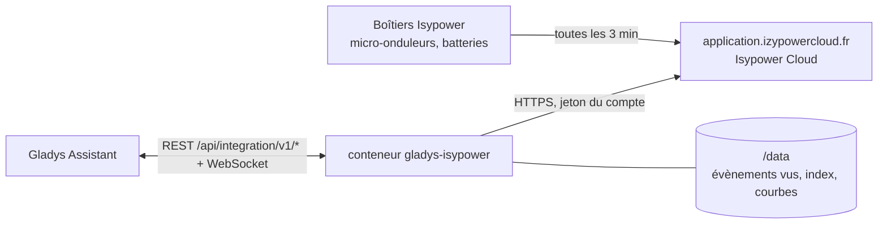
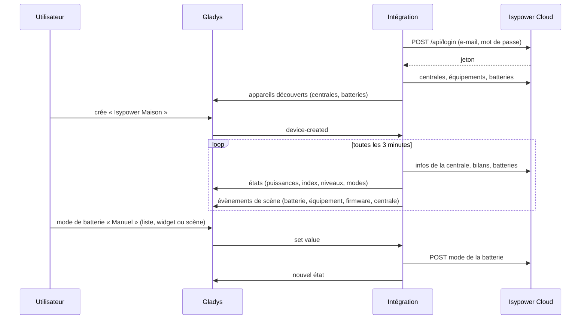
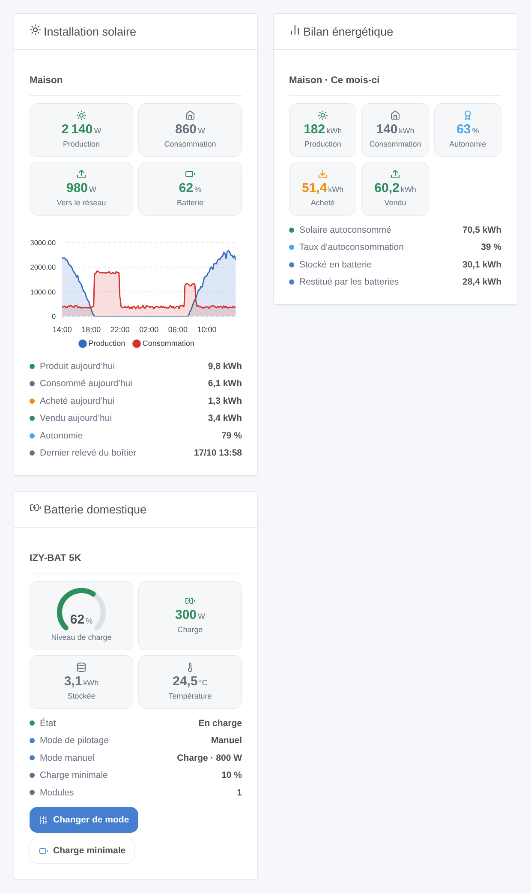

# Gladys Isypower

[English](README.md) · **Français** · [Deutsch](README.de.md) · [Español](README.es.md)

[](LICENSE)
[](https://github.com/William-De71/gladys-isypower/releases)
[](https://github.com/William-De71/gladys-isypower/actions/workflows/release.yml)
[](https://gladysassistant.com)


Intégration externe de [Gladys Assistant](https://gladysassistant.com) pour **Isypower Cloud** (Materfrance, anciennement Izypower) : la production solaire, la consommation de la maison, l’échange avec le réseau et les batteries domestiques de votre installation, avec des index d’énergie pour le suivi d’énergie de Gladys, les modes des batteries, des scènes et des widgets. Elle lit le cloud de l’application Isypower Cloud avec votre compte.

Documentation utilisateur : [English](docs/en.md) · [Français](docs/fr.md) · [Deutsch](docs/de.md) · [Español](docs/es.md).

> Intégration communautaire, ni développée ni approuvée par Materfrance. L’API d’Isypower Cloud n’est pas documentée : elle est utilisée comme le fait l’[intégration Home Assistant izypower_cloud](https://github.com/StefanPlizga/izypower_cloud).

## Fonctionnalités

- **Un appareil par centrale** : production solaire, consommation de la maison, échange signé avec le réseau, niveau et puissances des batteries.
- **Index d’énergie** pour Gladys : production solaire, énergie achetée au réseau (consommation et coût), énergie vendue, énergie stockée et restituée par les batteries. Un index ne baisse jamais.
- **Un appareil par batterie** : niveau, énergie stockée, puissances de charge et de décharge, température, prise de secours, et son **mode de pilotage** et son **mode manuel** en listes déroulantes.
- **4 déclencheurs**, **3 actions de scène** et **3 widgets** (ci-dessous).
- Lecture toutes les 3 minutes par défaut (les boîtiers remontent toutes les 3 minutes) ; une connexion refusée arrête les lectures pour ne jamais bloquer le compte.
- Quatre langues partout : anglais, français, allemand, espagnol.

## Fonctionnement




L’intégration se connecte avec l’e-mail et le mot de passe de l’application, liste les centrales du compte et lit, à chaque lecture, les données en direct de chaque centrale (puissances, niveau des batteries, dernier relevé du boîtier), les bilans du jour et depuis l’installation, ses équipements (micro-onduleurs, batteries, compteurs, bornes) et les données et réglages de chaque batterie. Elle les compare à la lecture précédente pour déclencher les scènes, et ne publie que les valeurs qui ont changé.



### Transport

Cloud uniquement (`transports: ["cloud"]`) : Gladys affiche le badge **cloud**. Les données quittent votre réseau par le cloud de Materfrance, exactement comme avec l’application. Rien n’est lu sur le réseau local.

## Appareils et fonctionnalités

| Appareil            | Fonctionnalité                                | Catégorie / type                                      | Unité |
| ------------------- | --------------------------------------------- | ----------------------------------------------------- | ----- |
| Isypower <centrale> | Production solaire                            | `energy-production-sensor` / `power`                  | W     |
|                     | Index de production solaire                   | `energy-production-sensor` / `index`                  | kWh   |
|                     | Consommation de la maison                     | `energy-sensor` / `power`                             | W     |
|                     | Échange avec le réseau (achat > 0, vente < 0) | `grid-sensor` / `power`                               | W     |
|                     | Énergie achetée au réseau                     | `energy-sensor` / `index`                             | kWh   |
|                     | Énergie vendue au réseau                      | `grid-sensor` / `output-index`                        | kWh   |
|                     | Niveau des batteries (avec batterie)          | `battery-storage` / `battery-level`                   | %     |
|                     | Charge / décharge des batteries               | `battery-storage` / `charge-power`, `discharge-power` | W     |
|                     | Énergie stockée / restituée par les batteries | `battery-storage` / `charge-index`, `discharge-index` | kWh   |
| Isypower <batterie> | Niveau de charge                              | `battery-storage` / `battery-level`                   | %     |
|                     | Énergie stockée                               | `battery-storage` / `battery-energy-remaining`        | kWh   |
|                     | Puissance de charge / de décharge             | `battery-storage` / `charge-power`, `discharge-power` | W     |
|                     | Température                                   | `device-temperature-sensor` / `decimal`               | °C    |
|                     | Prise de secours                              | `home-output-sensor` / `off-grid-power`               | W     |
|                     | Mode de pilotage (maître ou autonome)         | `text` / `select`                                     |       |
|                     | Mode manuel (maître ou autonome)              | `text` / `select`                                     |       |

Seul l’index de l’énergie **achetée** alimente la consommation et le coût de Gladys : c’est ce que compte la facture.

## Déclencheurs, actions de scène et widgets



| Type        | Clé                            | Usage                                                                                  |
| ----------- | ------------------------------ | -------------------------------------------------------------------------------------- |
| Déclencheur | `battery_state_changed`        | Une batterie se met en charge, en décharge ou en veille.                               |
| Déclencheur | `equipment_connection_changed` | Un micro-onduleur, une batterie, un compteur ou une borne passe hors ligne ou revient. |
| Déclencheur | `firmware_update_available`    | Isypower propose un nouveau firmware (vérifié toutes les six heures).                  |
| Déclencheur | `station_reporting_changed`    | Le boîtier n’a rien envoyé depuis 20 minutes, ou remonte à nouveau.                    |
| Action      | `set_battery_mode`             | Mode de pilotage ; en manuel veille, charge ou décharge à une puissance.               |
| Action      | `set_minimum_charge`           | Charge minimale d’une batterie (5 à 100 %).                                            |
| Action      | `get_energy_report`            | Énergie d’une période, autonomie et un résumé prêt à envoyer.                          |
| Widget      | `overview`                     | Installation solaire en ce moment, courbes des 24 h, énergie du jour.                  |
| Widget      | `report`                       | Bilan du jour, du mois, de l’année ou depuis l’installation.                           |
| Widget      | `battery`                      | Une batterie, avec des boutons pour son mode et sa charge minimale.                    |

Exemples :

- Chaque soir à 21 h → **lire le bilan énergétique** du jour → envoyer son résumé sur Telegram.
- Au début des heures pleines → **changer le mode de la batterie** en décharge manuelle à 800 W ; à la fin → retour au calendrier.
- Quand un micro-onduleur passe **hors ligne** ou que la centrale est **muette** → envoyer une notification.

## Prérequis

- Gladys Assistant **5.2.0** ou plus récent (formulaires de boutons, listes déroulantes). Les instances plus anciennes ne peuvent pas installer l’intégration.
- Un compte Isypower Cloud avec au moins une centrale, et un accès à internet depuis Gladys.

## Installation

- **Depuis le store** de Gladys (Intégrations → Intégrations externes), en un clic, une fois indexée.
- **Depuis l’URL du dépôt** : `https://github.com/William-De71/gladys-isypower`.
- **Mode développeur** : construisez l’image en local (`docker build -t gladys-isypower .`) et installez-la depuis Gladys.

## Configuration

| Champ             | Description                                                         |
| ----------------- | ------------------------------------------------------------------- |
| E-mail            | L’e-mail du compte Isypower Cloud.                                  |
| Mot de passe      | Son mot de passe (un secret : jamais réaffiché, jamais journalisé). |
| Lire toutes les   | 3 (par défaut), 5, 10 ou 15 minutes.                                |
| Langue des textes | Noms des appareils, modes des batteries, résumés des scènes.        |

Boutons : **Lire maintenant** (au plus une fois par minute, retente aussi une connexion refusée) et **Diagnostic** (écrit ce qui a été lu et la forme des réponses dans l’onglet Journaux, sans le mot de passe, le jeton ni les numéros de série).

## Utilisation

1. Saisissez l’e-mail et le mot de passe de l’application, puis enregistrez.
2. Dans l’onglet **Découverte**, créez les appareils des centrales et des batteries.
3. Ajoutez les widgets **Installation solaire**, **Bilan énergétique** et **Batterie domestique** à un tableau de bord, et créez des scènes avec les déclencheurs et actions ci-dessus.

## Développement

```bash
npm install
npm test                       # node --test, ne touche jamais le réseau
npm run lint && npm run format:check
npx github:GladysAssistant/integration-store . --skip-image-check
scripts/build-cover.sh         # cover.jpg depuis docs/assets/cover.svg
docs/illustrations/render.sh   # docs/assets/widgets.<langue>.png
node .github/scripts/release.mjs next
```

En local, le SDK lit `GLADYS_HOST_API_URL`, `GLADYS_INTEGRATION_TOKEN` et `GLADYS_INTEGRATION_SELECTOR` ; `DEBUG=gladys-integration-sdk` affiche les journaux du SDK et vérifie chaque contenu de widget. Les tests utilisent un faux Isypower Cloud (`test/helpers/fixtures.js`) dont les réponses sont reconstituées d’après l’intégration Home Assistant, pas capturées. Les règles du projet sont dans [CLAUDE.md](CLAUDE.md).

## Processus de release


Chaque fusion sur `main` lance la CI, puis calcule la version à partir des [Conventional Commits](https://www.conventionalcommits.org/) depuis le dernier tag : `feat` → mineure, `fix` / `perf` → correctif, `!` ou `BREAKING CHANGE` → majeure (une mineure sous 1.0.0) ; `docs`, `chore`, `ci`, `test`, `style`, `refactor`, `build` seuls ne publient rien. La section du changelog est générée, le tag poussé, l’image multi-architecture construite, puis `main` reçoit le commit de release, la GitHub Release est créée et un dernier job vérifie l’image publique, le validateur du store et le topic.

- Le titre de la pull request devient le commit squash, puis la ligne du changelog : écrivez-le en anglais, pour l’utilisateur (`pr-title.yml` le vérifie). Ne modifiez jamais `CHANGELOG.md` à la main.
- La 1.0.0 est une décision : Actions → Release → Run workflow avec `release-as: 1.0.0`. `dry-run` affiche la version et les notes sans rien publier.
- **Branche protégée** : la release pousse son commit sur `main` avec `GITHUB_TOKEN`. Avec un ruleset sur `main`, ajoutez GitHub Actions à sa liste de contournement (ou passez par une GitHub App), sinon le job de publication échoue avec des instructions.
- Après la première release, rendez public le package `ghcr.io` (Package settings → Change visibility), sinon Gladys ne peut pas le télécharger.

## Dépannage

Voir [docs/fr.md](docs/fr.md#dépannage). Signalez les problèmes avec les versions de Gladys et de l’intégration, votre matériel, et les lignes du bouton **Diagnostic**.

## Contribuer

Tickets et pull requests bienvenus. Lancez `npm run format:check && npm run lint && npm test` avant d’ouvrir une pull request, et ne changez aucun identifiant externe ni aucune clé stockée (voir [CLAUDE.md](CLAUDE.md)). Des captures de vraies réponses de l’API (sans données personnelles) sont les bienvenues : l’intégration a été écrite sans compte.

## Sécurité

Voir [SECURITY.md](SECURITY.md) : signalez les vulnérabilités en privé. Le mot de passe est un secret de Gladys, envoyé uniquement à Isypower Cloud en HTTPS ; ni le mot de passe ni le jeton ne sont écrits dans `/data` ni dans les journaux. Le conteneur tourne en lecture seule, avec un utilisateur non root.

## Captures à venir

Les images ci-dessus sont des illustrations, pas des captures d’écran. Les vraies captures iront dans `docs/assets/screenshots/` (PNG, 1280 × 800) : `configuration.png`, `discovery.png`, `station-device.png`, `battery-device.png`, `scene.png`.

## Licence

[Apache License 2.0](LICENSE) — voir aussi [NOTICE](NOTICE). Merci à la documentation et au SDK de Gladys, et à Stefan Plizga pour l’intégration Home Assistant izypower_cloud (MIT), qui a montré le fonctionnement de l’API d’Isypower Cloud.
