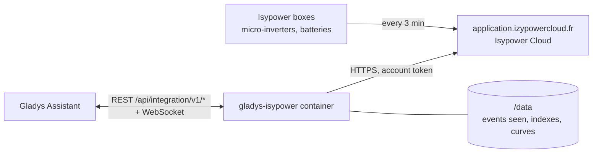
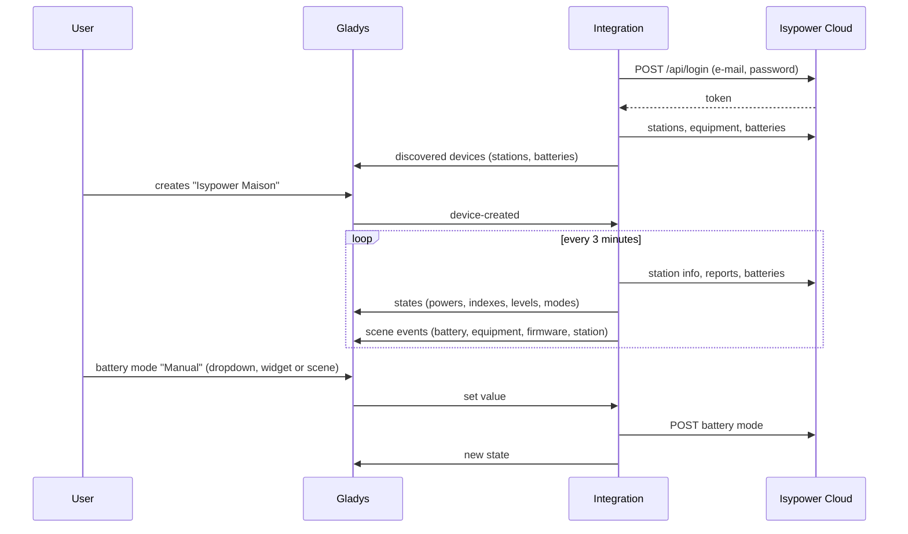
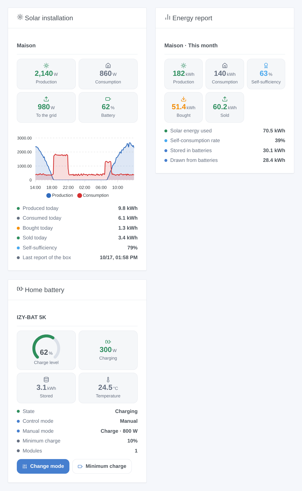

# Gladys Isypower

**English** · [Français](README.fr.md) · [Deutsch](README.de.md) · [Español](README.es.md)

[](LICENSE)
[](https://github.com/William-De71/gladys-isypower/releases)
[](https://github.com/William-De71/gladys-isypower/actions/workflows/release.yml)
[](https://gladysassistant.com)


[Gladys Assistant](https://gladysassistant.com) external integration for **Isypower Cloud** (Materfrance, formerly Izypower): the solar production, the house consumption, the grid exchange and the home batteries of your installation, with energy indexes for the energy tracking of Gladys, battery modes, scenes and dashboard widgets. It reads the cloud of the Isypower Cloud application with your account.

User documentation: [English](docs/en.md) · [Français](docs/fr.md) · [Deutsch](docs/de.md) · [Español](docs/es.md).

> Community integration, not developed nor endorsed by Materfrance. The API of Isypower Cloud is not documented: it is used the way the [Home Assistant integration izypower_cloud](https://github.com/StefanPlizga/izypower_cloud) uses it.

## Features

- **One device per power station**: solar production, house consumption, signed grid exchange, battery level and powers.
- **Energy indexes** for Gladys: solar production, energy bought from the grid (consumption and cost), energy sold, energy stored in and drawn from the batteries. An index never goes down.
- **One device per battery**: level, stored energy, charging and discharging powers, temperature, backup outlet, and its **control mode** and **manual mode** as dropdowns.
- **4 scene triggers**, **3 scene actions** and **3 dashboard widgets** (below).
- Read every 3 minutes by default (the boxes report every 3 minutes); a refused login stops the readings so that the account is never locked.
- Four languages everywhere: English, French, German, Spanish.

## How it works




The integration logs in with the e-mail and password of the application, lists the stations of the account and reads, at each reading, the live data of each station (powers, battery level, last report of the box), today's and lifetime energy reports, its equipment (micro-inverters, batteries, meters, charging stations) and the live data and settings of each battery. It compares them with the previous reading to fire the scene triggers, and publishes only the values that changed.



### Transport

Cloud only (`transports: ["cloud"]`): Gladys shows the **cloud** badge. The data leave your network through the cloud of Materfrance, exactly as with the application. Nothing is read from the local network.

## Devices and features

| Device             | Feature                                     | Category / type                                       | Unit |
| ------------------ | ------------------------------------------- | ----------------------------------------------------- | ---- |
| Isypower <station> | Solar production                            | `energy-production-sensor` / `power`                  | W    |
|                    | Solar production index                      | `energy-production-sensor` / `index`                  | kWh  |
|                    | House consumption                           | `energy-sensor` / `power`                             | W    |
|                    | Grid exchange (import > 0, export < 0)      | `grid-sensor` / `power`                               | W    |
|                    | Energy bought from the grid                 | `energy-sensor` / `index`                             | kWh  |
|                    | Energy sold to the grid                     | `grid-sensor` / `output-index`                        | kWh  |
|                    | Battery level (with a battery)              | `battery-storage` / `battery-level`                   | %    |
|                    | Battery charging / discharging              | `battery-storage` / `charge-power`, `discharge-power` | W    |
|                    | Energy stored in / drawn from the batteries | `battery-storage` / `charge-index`, `discharge-index` | kWh  |
| Isypower <battery> | Charge level                                | `battery-storage` / `battery-level`                   | %    |
|                    | Stored energy                               | `battery-storage` / `battery-energy-remaining`        | kWh  |
|                    | Charging / discharging power                | `battery-storage` / `charge-power`, `discharge-power` | W    |
|                    | Temperature                                 | `device-temperature-sensor` / `decimal`               | °C   |
|                    | Backup outlet                               | `home-output-sensor` / `off-grid-power`               | W    |
|                    | Control mode (master or standalone)         | `text` / `select`                                     |      |
|                    | Manual mode (master or standalone)          | `text` / `select`                                     |      |

Only the index of the energy **bought** feeds the consumption and cost of Gladys: that is what the bill counts.

## Scene triggers, actions and widgets



| Kind    | Key                            | Use                                                                              |
| ------- | ------------------------------ | -------------------------------------------------------------------------------- |
| Trigger | `battery_state_changed`        | A battery starts charging, discharging or goes on standby.                       |
| Trigger | `equipment_connection_changed` | A micro-inverter, battery, meter or charging station goes offline or comes back. |
| Trigger | `firmware_update_available`    | Isypower offers a new firmware (checked every six hours).                        |
| Trigger | `station_reporting_changed`    | The box has sent nothing for 20 minutes, or reports again.                       |
| Action  | `set_battery_mode`             | Control mode; in manual control standby, charge or discharge at a power.         |
| Action  | `set_minimum_charge`           | Minimum charge of a battery (5 to 100 %).                                        |
| Action  | `get_energy_report`            | Energy of a period, self-sufficiency and a ready-made summary.                   |
| Widget  | `overview`                     | Solar installation now, curves of the last 24 hours, today's energy.             |
| Widget  | `report`                       | Energy report of today, the month, the year or since installation.               |
| Widget  | `battery`                      | A battery, with buttons to change its mode and minimum charge.                   |

Examples:

- Every evening at 9 pm → **read the energy report** of today → send its summary on Telegram.
- At the start of peak hours → **set the battery mode** to manual discharge at 800 W; at the end → back to calendar.
- When a micro-inverter goes **offline** or the station is **silent** → send a notification.

## Requirements

- Gladys Assistant **5.2.0** or later (button forms, dropdown features). Older instances cannot install the integration.
- An Isypower Cloud account with at least one station, and internet access from Gladys.

## Installation

- **From the store** of Gladys (Integrations → External integrations), in one click, once indexed.
- **From the repository URL**: `https://github.com/William-De71/gladys-isypower`.
- **Developer mode**: build the image locally (`docker build -t gladys-isypower .`) and install it from Gladys.

## Configuration

| Field                 | Description                                               |
| --------------------- | --------------------------------------------------------- |
| E-mail                | The e-mail of the Isypower Cloud account.                 |
| Password              | Its password (a secret: never shown again, never logged). |
| Read every            | 3 (default), 5, 10 or 15 minutes.                         |
| Language of the texts | Device names, battery modes, scene summaries.             |

Buttons: **Read now** (at most once a minute, also retries a refused login) and **Diagnostic** (writes what was read and the shape of the answers to the Logs tab, without the password, the token nor the serial numbers).

## Usage

1. Enter the e-mail and the password of the application, then save.
2. In the **Discover** tab, create the station and battery devices.
3. Add the **Solar installation**, **Energy report** and **Home battery** widgets to a dashboard, and build scenes with the triggers and actions above.

## Development

```bash
npm install
npm test                       # node --test, never touches the network
npm run lint && npm run format:check
npx github:GladysAssistant/integration-store . --skip-image-check
scripts/build-cover.sh         # cover.jpg from docs/assets/cover.svg
docs/illustrations/render.sh   # docs/assets/widgets.<lang>.png
node .github/scripts/release.mjs next
```

Locally, the SDK reads `GLADYS_HOST_API_URL`, `GLADYS_INTEGRATION_TOKEN` and `GLADYS_INTEGRATION_SELECTOR`; `DEBUG=gladys-integration-sdk` shows the SDK logs and checks every widget content. The tests use a fake Isypower Cloud (`test/helpers/fixtures.js`) whose answers are reconstructed from the Home Assistant integration, not captured. The rules of the project are in [CLAUDE.md](CLAUDE.md).

## Release process


Every merge on `main` runs the CI, then computes the version from the [Conventional Commits](https://www.conventionalcommits.org/) since the last tag: `feat` → minor, `fix` / `perf` → patch, `!` or `BREAKING CHANGE` → major (a minor below 1.0.0); `docs`, `chore`, `ci`, `test`, `style`, `refactor`, `build` alone publish nothing. The changelog section is generated, the tag pushed, the multi-architecture image built, then `main` receives the release commit, the GitHub Release is created and a last job checks the public image, the store validator and the topic.

- The pull request title becomes the squash commit, then the changelog line: write it in English, for the user (`pr-title.yml` checks it). Never edit `CHANGELOG.md` by hand.
- 1.0.0 is a decision: Actions → Release → Run workflow with `release-as: 1.0.0`. `dry-run` shows the version and the notes without publishing.
- **Protected branch**: the release pushes its commit to `main` with `GITHUB_TOKEN`. With a ruleset on `main`, add GitHub Actions to its bypass list (or push through a GitHub App), otherwise the publish job fails with instructions.
- After the first release, make the `ghcr.io` package public (Package settings → Change visibility), or Gladys cannot pull it.

## Troubleshooting

See [docs/en.md](docs/en.md#troubleshooting). Report issues with the versions of Gladys and of the integration, your equipment, and the lines of the **Diagnostic** button.

## Contributing

Issues and pull requests are welcome. Run `npm run format:check && npm run lint && npm test` before opening a pull request, and keep every external id and stored key unchanged (see [CLAUDE.md](CLAUDE.md)). Captures of real answers of the API (without personal data) are very welcome: the integration was written without an account.

## Security

See [SECURITY.md](SECURITY.md): report vulnerabilities privately. The password is a secret of Gladys, sent only to Isypower Cloud over HTTPS; neither the password nor the token is written to `/data` or to the logs. The container runs read-only, as a non-root user.

## Screenshots to come

The images above are illustrations, not screenshots. Real screenshots will go in `docs/assets/screenshots/` (PNG, 1280 × 800): `configuration.png`, `discovery.png`, `station-device.png`, `battery-device.png`, `scene.png`.

## License

[Apache License 2.0](LICENSE) — see also [NOTICE](NOTICE). Thanks to the Gladys documentation and SDK, and to Stefan Plizga for the Home Assistant integration izypower_cloud (MIT), which showed how the API of Isypower Cloud works.
